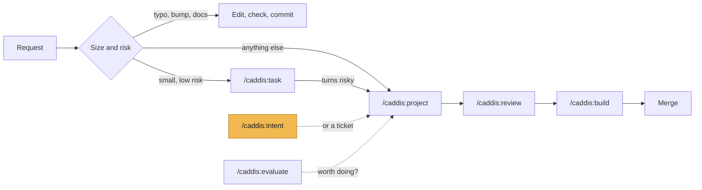
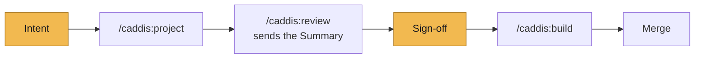

<p align="center"></p>

<p align="center">Projects, tasks and a codebase map for Claude Code, set up from your own repo.</p>


A caddisfly larva builds its case from whatever is nearby: sand, twigs, bits of shell.
`/caddis:init` does the same with a repo. It reads the code, CI, docs and git history and
writes `.caddis/caddis.md`: the commands, the rules that must never break, what counts as
risky, the commit style. Every Caddis skill reads that file, so the skills stay generic and
the repo-specific facts live in one place you can edit.

- **Projects.** Write up a piece of work, review it once, then let Claude build it
  unattended. The build records its decisions instead of asking.
- **Tasks.** Small changes skip the ceremony: a short task file, the change, the checks, a
  commit. Typos and bumps skip Caddis entirely.
- **Intents.** Product owners say what they want in product terms, then sign off one plain
  Summary. They're never asked a technical question.
- **The map.** An import graph of your code, plus a short guide to what lives where. A hook
  says when it is out of date.

## Contents

- [Install](#install)
- [How work flows](#how-work-flows)
- [Skills](#skills)
- [Solo, team, or team with product owners](#solo-team-or-team-with-product-owners)
- [Adapting Caddis](#adapting-caddis)
- [Reference](#reference): files, project format, map, agents, build progress, settings

## Install

```
claude plugin install caddis --marketplace adivmaimon/caddis
```

Or inside Claude Code: `/plugin marketplace add adivmaimon/caddis`, then
`/plugin install caddis@caddis`. In the VS Code extension the command is `/plugins`.

Then, in your repo:

```
/caddis:init
```

Init builds the map, writes `.caddis/caddis.md`, asks its questions in one batch (your
rules, anything it had to guess, how your team works) and commits.

Needs Claude Code with plugin support, git, and Python 3.8+ for the map script.

## How work flows

Every change takes one of three paths, by size and risk:



- **Project:** a file in `.caddis/projects/active/` saying what changes, the risk, and a
  gate a machine can check for each phase.
- **Review:** checks every project against the code and asks you all its questions in one
  batch. It is the last time anyone is asked anything.
- **Build:** runs each project phase by phase in the background. Every phase passes its
  gate and gets its own commit. When a project is done it moves to `completed/` with what
  was built and why.
- **Parallel builds:** projects that share no files build side by side, each in its own
  copy of the code (a git worktree) on its own branch. After each batch the integrator
  merges them in order and runs the tests after each merge; a real clash is stopped and
  reported, never overwritten. Projects that share files build one after another. Files
  every project touches, like a version file, go on the `Merge by rule` line in
  `caddis.md` so they don't force a queue.
- **Stops:** only for the hard stops in `caddis.md`: publishing, spending money, secrets,
  deleting outside the repo, destructive commands against a shared database. You can add
  more.

A change is a task only if all of these hold, otherwise it is a project:
- about 3 files or fewer, in one layer
- nothing on the Risk list in `caddis.md`
- no rule from `caddis.md` touched
- no experiment needed to pick the approach
- one commit can revert it

## Skills

| Skill | What it does |
| --- | --- |
| `/caddis:init` | Sets up Caddis in a repo, or refreshes it: config, map, CLAUDE.md |
| `/caddis:config` | Changes settings and team rules from plain words |
| `/caddis:learn` | Start of a session: recent commits, open projects, map and log health |
| `/caddis:intent` | A product owner's request: problem, outcome, done when, in a file or a ticket |
| `/caddis:evaluate` | Is this worth doing? Verdict, impact per layer, risk, alternatives |
| `/caddis:task` | A small change: task file, change, checks, commit |
| `/caddis:project` | Anything bigger: writes a project, from an intent or ticket if there is one |
| `/caddis:review` | Checks projects, asks everything at once, sends the Summary for sign-off |
| `/caddis:build` | Runs every reviewed project, unattended |
| `/caddis:execute` | Runs one project |
| `/caddis:tests` | Writes and runs tests for a change, riskiest behaviour first |
| `/caddis:commit` | Commits only this chunk of work, with a conventional message |
| `/caddis:complete` | Adds the outcome and moves a project to `completed/` (build does this for you) |
| `/caddis:map` | Builds or refreshes the codebase map: the import graph and `STRUCTURE.md` |
| `/caddis:maintenance` | Monthly full audit, with a log carried between runs |

You can also ask in plain words ("create a task to...", "create a project for..."). Naming
the skill is more reliable. With no project named, review and build work on the projects
your branch added, so teammates' work is left alone.

## Solo, team, or team with product owners

The same skills fit all three. Init asks which one you are.

| | Solo | Engineering team | Team with product owners |
| --- | --- | --- | --- |
| `.caddis/` | Committed, or gitignored to keep projects private | Committed: `caddis.md` is the team's rulebook | Committed |
| Product section in `caddis.md` | Empty | Empty | Owners, tracker, sign-off route |
| Who answers review | You | The engineer running it | Engineer: technical. Product owner: the Summary |
| Where projects are read | Locally | In the branch's PR | In the PR, with sign-off on the ticket or PR |

**Solo.** Review is optional: build reviews any unreviewed project itself, takes the
recommended answers and records that it did. `project`, then `build`, is enough.

**Engineering team.** Each project lands as a `docs:` commit on your branch, so teammates
read it in the PR before or alongside the code. Agree team-wide changes in `caddis.md`.

**With product owners.** The product owner does two things: writes the intent, and signs
off the project's Summary. Engineers do the rest. By default a project waits for sign-off
before it builds:



The intent lives in `.caddis/intents/active/`, or stays as the ticket. When its project is
built, it moves to `completed/` and, for tickets, Claude posts what shipped in plain
language. Set `Wait for sign-off: no` to build before sign-off; the intent then stays open
until the owner signs off.

## Adapting Caddis

Run `/caddis:config` and say what you want in plain words: "stop after every phase",
"never touch `legacy/`", "post to the release channel after each build". It shows what's
set, decides where each change belongs, shows you the diff and commits it. You can also
edit the files by hand. There are three kinds of change.

**Switches** in the Workflow section of `caddis.md`, for the common changes:

```markdown
## Workflow

- Pause after each phase: yes      # build stops after every phase; run it again to continue
- Unreviewed projects: skip        # build only runs projects /caddis:review marked
- Wait for sign-off: yes           # a project waits for the product owner (the default)
- Build panel: off                 # no live panel during a build; the status line shows it
- Merge by rule: package.json      # files parallel builds may share; the integrator merges them
```

**Team rules** for anything else: `.caddis/extend/<skill>.md`, named after the skill or
agent it changes. Every skill and agent reads its file first and follows it. A team rule can
add steps, change them or add hard stops. It can never remove a hard stop, weaken a gate,
silence a check or skip the gate-verifier.

```markdown
# Team rules: build

## Before
- Rebase the branch on main. (owner, 2026-11-10)

## Each phase
- Run the `preview-deploy` skill and paste its URL into the project. (owner, 2026-11-10)

## Always
- Never touch anything under `legacy/`. (owner, 2026-11-10)
```

Names you can extend: `init`, `config`, `learn`, `intent`, `evaluate`, `task`, `project`,
`review`, `build`, `execute`, `tests`, `commit`, `complete`, `map`, `maintenance`, and the
agents `plan-reviewer`, `gate-verifier`, `auditor`, `builder` and `integrator`.

**Your own skills** go in `.claude/skills/`. List each under Local skills in `caddis.md`
with when to use it, and Caddis skills will call it at the right moment. Team rules can call
them too, as in the example above.

### Updates keep your setup

A Caddis update replaces the plugin and nothing in your repo. `caddis.md`, team rules,
intents and projects are yours:
- `/caddis:init` run again proposes changes to `caddis.md` as a diff, keeps everything you
  wrote, and never writes to `.caddis/extend/`.
- `/caddis:learn` fixes stale paths in `caddis.md` but only reports problems in team rules.
- When an update adds settings, a line at session start says so. `/caddis:config` lists
  them with their defaults and adds the ones you pick. A setting you haven't added
  already works at its default.

Only `.caddis/bin/map.py` and the Caddis block in `CLAUDE.md` (between its markers) are
replaced on re-init. Put your own CLAUDE.md rules outside the markers.

## Reference

### Files

```
.caddis/
  caddis.md              commands, stack, rules, risk, product, workflow, docs, commits,
                         tests, hard stops
  extend/                team rules, one file per skill (optional, via /caddis:config)
  intents/active/        product intents not yet delivered (when Product is on)
  intents/completed/     delivered intents
  projects/active/       projects and tasks in progress
  projects/completed/    finished projects and tasks
  map/STRUCTURE.md       the map Claude reads (committed)
  map/graph.json         the import graph (gitignored, rebuilt when needed)
  bin/map.py             the map script, so the repo works without the plugin
CLAUDE.md                a short block pointing at the above
.claude/settings.json    Caddis skills and your commands allowed; git push and sudo denied
.claude/skills/          repo-specific skills where the repo needs one (release,
                         migrations, bench, logs)
```

Projects already in `.claude/projects/active` and `completed` are moved into
`.caddis/projects/` with `git mv`, if you agree. Running init again merges with what is
there and shows you the changes first.

### Project format

```markdown
# Title

**Status:** Pending
**Type:** Project
**Intent:** ABC-123
**Reviewed:** 2026-10-27
**Signed off:** Sam 2026-10-28

### Phase 1 - The engine - DONE (2026-10-28)
### Phase 2 - The UI
```

[Monty](https://github.com/adivmaimon/monty) reads these lines to show project progress in
VS Code and the Mac menu bar.

Every commit made for a project or task ends with a trailer naming it, so git can answer
"which project changed this?":

```
feat(search): rank exact matches first

Caddis-Plan: project-search-index
```

```bash
git log --grep "Caddis-Plan: project-search-index"                          # that project's commits
git log --format='%h %(trailers:key=Caddis-Plan,valueonly,separator=%x2C )'  # project per commit
```

Repos that keep `.caddis/` gitignored get no trailer, so private projects stay out of
history.

### The map

```
python3 .caddis/bin/map.py build            # write graph.json and summary.md
python3 .caddis/bin/map.py status           # is STRUCTURE.md out of date, and where
python3 .caddis/bin/map.py uses <file>      # what imports this (--depth 2 for indirect)
python3 .caddis/bin/map.py deps <file>      # what this imports
python3 .caddis/bin/map.py area <dir>       # files in an area, imported by and importing
python3 .caddis/bin/map.py reach <files>    # what a change to these files can reach
python3 .caddis/bin/map.py orphans [--json] # files nothing imports
```

Resolves imports in TypeScript and JavaScript (tsconfig paths, `@/` aliases, React Native
platform files, Vue, Svelte), Python, Go, Rust, PHP (PSR-4), Ruby, Java, Kotlin, C,
Objective-C, Dart, CSS, SCSS and Less. Swift and C# files appear without edges. An import it
can't resolve is counted in `summary.md`, never guessed. Nine real repos of 30 to 1,300
source files each mapped in under two seconds.

### Agents

Five agents. The three reviewers check work without the context of whoever did it and change
nothing. The builder and the integrator do the build itself. None of them pushes, runs two
heavy jobs at once or touches anything on the hard stops list.

| Agent | When it runs | What it does | Edits code |
| --- | --- | --- | --- |
| `plan-reviewer` | `/caddis:review`, once per project | Reads the project cold against the code and reports only problems: wrong paths, gates a machine can't check, broken rules, missed risks | No |
| `gate-verifier` | Every phase gate in `/caddis:execute` and `/caddis:build` | Gets the project and phase number, nothing more. Compares the diff with the project, checks the rules, reruns the gate and answers PASS, FAIL or INCOMPLETE | No |
| `auditor` | `/caddis:maintenance`, once per focus; `/caddis:evaluate` for wide areas | Sweeps one focus (invariants, reuse, comments, performance, tests, security, docs, AI cost) and returns findings with file and line | No |
| `builder` | `/caddis:build` and `/caddis:execute`, in the background, one per project when builds run side by side | Builds its projects phase by phase, passes each gate and commits, deciding and recording instead of asking | Yes, inside the repo, on its own branch. Never pushes or merges |
| `integrator` | `/caddis:build`, after each wave of parallel builds | Merges each builder's branch in build order, runs the tests after every merge, and resolves only the files on the Merge by rule line. Any other clash is aborted and reported | Merges only, never writes code. Never pushes |

### Build progress

`/caddis:build` and `/caddis:execute` run in a background agent, so the session stays free,
and report status based on the estimated build length:

| Estimate | Reports |
| --- | --- |
| Under 5 minutes | None until done |
| 5 to 30 minutes | Every 5 minutes |
| 30 to 60 minutes | Every 10 minutes |
| 1 to 2 hours | Every 15 minutes |
| Over 2 hours | Every 30 minutes |

The estimate is replaced by the measured pace once a phase finishes. A build with no commits
or file changes for 20 minutes is flagged as possibly stuck.

In Claude Code versions with mods, a **Caddis build** panel also opens beside the chat when a
build starts: each project's phases, the one in progress, a progress bar, time against the
estimate and a warning when the build goes quiet. It updates as phases finish and stays open
showing done. `/caddis-panel` opens it again. Where a panel can't be placed, or with
`Build panel: off` in the Workflow section, the same progress shows on the status line under
the prompt. The text reports above stay the same everywhere, so surfaces without mods lose
nothing.

### Settings

- `CADDIS_QUIET=1` hides the `caddis · <skill>` line shown when a skill starts. The line
  appears in the terminal; the VS Code panel doesn't show hook messages.

## Principles

- **The repo's facts live in one file.** Skills say when to do something; `caddis.md` says
  how, for this repo. Upgrading Caddis never touches your config or team rules.
- **Nothing invented.** Init only records rules the repo already states. The map only draws
  edges it can resolve.
- **Ask once.** Questions are batched at init and review. The build decides and writes down
  why.
- **Stop for what can't be undone.** Publishing, money, secrets, deletions outside the repo
  and destructive commands against shared data wait for you.

## Contributing

See [CONTRIBUTING.md](CONTRIBUTING.md). Tests: `python3 -m unittest discover tests`. Keep
skills generic; anything about one repo belongs in that repo's `caddis.md`.

## License

[MIT](LICENSE). Made by [Adiv Maimon](https://adivmaimon.com).
