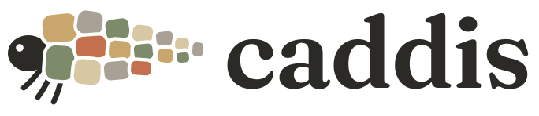
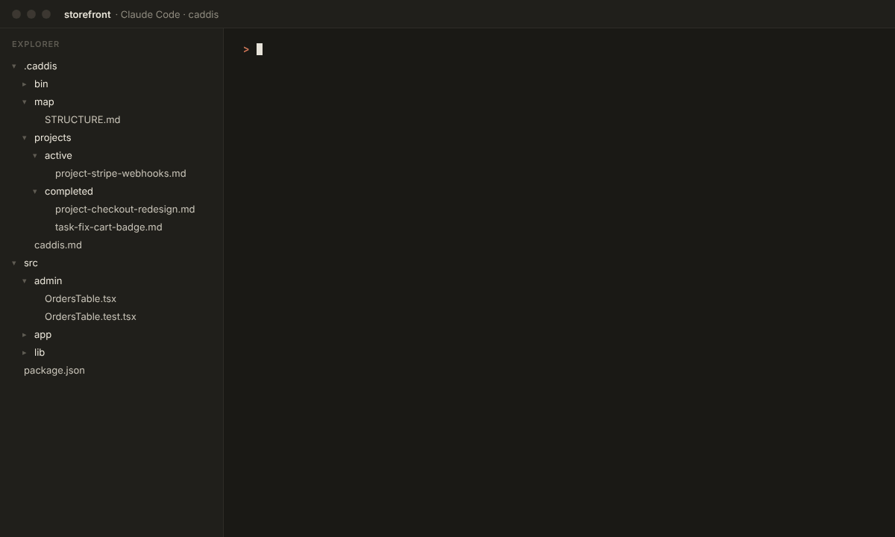

<p align="center"></p>

<p align="center">Plans, tasks and a codebase map for Claude Code, set up from your own repo.</p>



A caddisfly larva builds its case from whatever is nearby: sand, twigs, bits of shell.
`/caddis:init` does the same with a repo. It reads the code, CI, docs and git history and
writes `.caddis/caddis.md`: the commands, the rules that must never break, what counts as
risky, the commit style. Every Caddis skill reads that file, so the skills stay generic and
the repo-specific facts live in one place you can edit.

- **Projects.** Evaluate an idea, write a plan, review all open plans in one pass, then build
  them unattended. The build records its decisions instead of asking, and stops only for
  publishing, spending money, secrets, or deleting outside the repo.
- **Tasks.** Small changes skip the plan. `/caddis:task` writes a short task file, makes the
  change, runs the checks and commits. If the work turns out risky, it becomes a project.
- **The map.** A script builds the import graph from the imports in your code. Claude writes
  `STRUCTURE.md` on top of it: areas, entry points, the most-imported files, the main flows,
  where new code goes. A hook at session start says when it is out of date.

Finished plans and tasks stay in `.caddis/projects/completed/` with what was built and why.

## Install

```
claude plugin install caddis --marketplace adivmaimon/caddis
```

Or inside Claude Code: `/plugin marketplace add adivmaimon/caddis`, then
`/plugin install caddis@caddis`. In the VS Code extension the command is `/plugins`.

Then, in your repo:

```
/caddis:init
```

Init builds the map, writes `.caddis/caddis.md`, asks its questions in one batch (your
rules, anything it had to guess) and commits.

Needs Claude Code with plugin support, git, and Python 3.8+ for the map script.

## Skills

| When | Skill |
| --- | --- |
| Start of a session | `/caddis:learn`: recent commits, open plans, map and log health |
| Is this worth doing? | `/caddis:evaluate`: verdict, impact per layer, risk, alternatives |
| A small change | `/caddis:task` |
| Anything bigger | `/caddis:project`: a plan in `.caddis/projects/active/` |
| Before building | `/caddis:review`: checks every plan, asks you everything at once |
| Build | `/caddis:build`: runs every reviewed plan, unattended |
| Build one plan | `/caddis:execute` |
| Tests | `/caddis:tests` |
| Commit | `/caddis:commit`: stages only this chunk of work |
| Done | `/caddis:complete`: adds the outcome and moves it to `completed/` |
| Map | `/caddis:map` |
| Monthly | `/caddis:maintenance`: full audit, with a log carried between runs |

You can also ask in plain words ("create a task to...", "write a plan for..."). Naming the
skill is more reliable.

A change is a task only if all of these hold, otherwise it is a project:
- about 3 files or fewer, in one layer
- nothing on the Risk list in `caddis.md`
- no rule from `caddis.md` touched
- no experiment needed to pick the approach
- one commit can revert it

## Agents

Three read-only agents. Two check work without the context of whoever did it, and one keeps
wide sweeps out of the main session:
- `plan-reviewer`: `/caddis:review` hands it each plan. It checks paths, gates, rules and
  risks against the code and reports only problems.
- `gate-verifier`: at every phase gate, `/caddis:execute` and `/caddis:build` hand it the
  plan and phase number, nothing more. It compares the diff with the plan, checks the rules,
  reruns the gate's checks and answers PASS, FAIL or INCOMPLETE. It never runs heavy jobs or
  anything on the hard stops list.
- `auditor`: `/caddis:maintenance` hands it one focus at a time (invariants, reuse,
  comments, performance, tests, security, docs, AI cost) and keeps only its findings, each
  with file, line and whether it is a quick fix or needs a plan.

## What init creates

```
.caddis/
  caddis.md              commands, stack, layers, rules, risk, docs, commits, tests,
                         hard stops
  projects/active/       plans and tasks in progress
  projects/completed/    finished plans and tasks
  map/STRUCTURE.md       the map Claude reads (committed)
  map/graph.json         the import graph (gitignored, rebuilt when needed)
  bin/map.py             the map script, so the repo works without the plugin
CLAUDE.md                a short block pointing at the above
.claude/settings.json    Caddis skills and your commands allowed; git push and sudo denied
.claude/skills/          repo-specific skills where the repo needs one (release,
                         migrations, bench, logs)
```

Plans already in `.claude/projects/active` and `completed` are moved into
`.caddis/projects/` with `git mv`, if you agree.

Running init again merges with what is there and shows you the changes first.

## The map

```
python3 .caddis/bin/map.py build            # write graph.json and summary.md
python3 .caddis/bin/map.py status           # is STRUCTURE.md out of date, and where
python3 .caddis/bin/map.py uses <file>      # what imports this (--depth 2 for indirect)
python3 .caddis/bin/map.py deps <file>      # what this imports
python3 .caddis/bin/map.py area <dir>       # files in an area, imported by and importing
python3 .caddis/bin/map.py orphans          # files nothing imports
```

Resolves imports in TypeScript and JavaScript (tsconfig paths, `@/` aliases, React Native
platform files, Vue, Svelte), Python, Go, Rust, PHP (PSR-4), Ruby, Java, Kotlin, C,
Objective-C, Dart, CSS, SCSS and Less. Swift and C# files appear without edges. An import it
can't resolve is counted in `summary.md`, never guessed. Nine real repos of 30 to 1,300
source files each mapped in under two seconds.

## Plan format

```markdown
# Title

**Status:** Pending
**Type:** Project
**Reviewed:** 2026-10-27

### Phase 1 - The engine - DONE (2026-10-28)
### Phase 2 - The UI
```

[Monty](https://github.com/adivmaimon/monty) reads these lines to show plan progress in VS Code
and the Mac menu bar.

## Settings

- `CADDIS_QUIET=1` hides the `caddis · <skill>` line shown when a skill starts. The line
  appears in the terminal; the VS Code panel doesn't show hook messages.
- Your own skills go in `.claude/skills/`. List them under Local skills in `caddis.md` so
  Caddis skills know when to call them.

## Principles

- **The repo's facts live in one file.** Skills say when to do something; `caddis.md` says
  how, for this repo. Upgrading Caddis never touches your config.
- **Nothing invented.** Init only records rules the repo already states. The map only draws
  edges it can resolve.
- **Ask once.** Questions are batched at init and review. The build decides and writes down
  why.
- **Stop for what can't be undone.** Publishing, money, secrets and deletions outside the
  repo wait for you.

## Contributing

See [CONTRIBUTING.md](CONTRIBUTING.md). Tests: `python3 -m unittest discover tests`. Keep skills generic; anything about one repo
belongs in that repo's `caddis.md`.

## License

[MIT](LICENSE). Made by [Adiv Maimon](https://adivmaimon.com).
