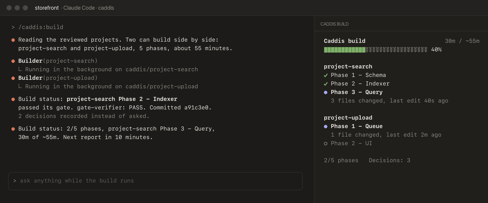

# Caddis

Projects, tasks and a codebase map for Claude Code, set up from your own repo.

A caddisfly larva builds its case from whatever is nearby: sand, twigs, bits of shell.
`/caddis:init` does the same with a repo. It reads the code, CI, docs and git history and
writes `.caddis/caddis.md`: the commands, the rules that must never break, what counts as
risky, the commit style. Every Caddis skill reads that file, so the skills stay generic and
the repo-specific facts live in one place you can edit.

- **Projects.** Write up a piece of work, review it once, then let Claude build it
  unattended. The build records its decisions instead of asking.
- **Tasks.** Small changes skip the ceremony: a short task file, the change, the checks, a
  commit. Typos and version bumps skip Caddis entirely.
- **Intents.** Product owners say what they want in product terms, then sign off one plain
  Summary. They're never asked a technical question.
- **The map.** An import graph of your code, plus a short guide to what lives where. A hook
  says when it is out of date.

## Install

```
claude plugin install caddis --marketplace adivmaimon/caddis
```

Or inside Claude Code: `/plugin marketplace add adivmaimon/caddis`, then
`/plugin install caddis@caddis`. In the VS Code extension the command is `/plugins`.

Then, in your repo:

```
/caddis:init
```

Init builds the map, writes `.caddis/caddis.md`, asks its questions in one batch (your
rules, anything it had to guess, how your team works) and commits.

Needs Claude Code with plugin support, git, and Python 3.8+ for the map script.

## How work flows

Small changes are tasks. Anything bigger is a project: write it with `/caddis:project`,
check it with `/caddis:review`, then `/caddis:build` runs it unattended, one checked commit
per phase. It stops only for the hard stops in `caddis.md`.

Projects that share no files build side by side, each in its own copy of the code, and are
merged one at a time with the tests run after each merge. A project that depends on another
waits for it.

While a build runs, a Caddis build panel beside the chat shows each phase as it finishes,
and the files changed in the phase in progress.
Where a panel can't be drawn, or with `Build panel: off`, the status line shows it instead.



A change is a task only if all of these hold, otherwise it is a project:
- about 3 files or fewer, in one layer
- nothing on the Risk list in `caddis.md`
- no rule from `caddis.md` touched
- no experiment needed to pick the approach
- one commit can revert it

## Agents

| Agent | When it runs | What it does | Edits code |
| --- | --- | --- | --- |
| `plan-reviewer` | `/caddis:review`, once per project | Reads the project cold against the code and reports only problems: wrong paths, gates a machine can't check, broken rules, missed risks | No |
| `gate-verifier` | Every phase gate in `/caddis:execute` and `/caddis:build` | Gets the project and phase number, nothing more. Compares the diff with the project, checks the rules, reruns the gate and answers PASS, FAIL or INCOMPLETE | No |
| `auditor` | `/caddis:maintenance`, once per focus; `/caddis:evaluate` for wide areas | Sweeps one focus (invariants, reuse, comments, performance, tests, security, docs, AI cost) and returns findings with file and line | No |
| `builder` | `/caddis:build` and `/caddis:execute`, in the background, one per project when builds run side by side | Builds its projects phase by phase, passes each gate and commits, deciding and recording instead of asking | Yes, inside the repo, on its own branch. Never pushes or merges |
| `integrator` | `/caddis:build`, after each wave of parallel builds | Merges each builder's branch in build order, runs the tests after every merge, and resolves only the files on the Merge by rule line. Any other clash is aborted and reported | Merges only, never writes code. Never pushes |

## Skills

| Skill | What it does |
| --- | --- |
| `/caddis:init` | Sets up Caddis in a repo, or refreshes it: config, map, CLAUDE.md |
| `/caddis:config` | Changes settings and team rules from plain words |
| `/caddis:learn` | Start of a session: recent commits, open projects, map and log health |
| `/caddis:intent` | A product owner's request: problem, outcome, done when, in a file or a ticket |
| `/caddis:evaluate` | Is this worth doing? Verdict, impact per layer, risk, alternatives |
| `/caddis:task` | A small change: task file, change, checks, commit |
| `/caddis:project` | Anything bigger: writes a project, from an intent or ticket if there is one |
| `/caddis:review` | Checks projects, asks everything at once, sends the Summary for sign-off |
| `/caddis:build` | Runs every reviewed project, unattended |
| `/caddis:execute` | Runs one project |
| `/caddis:tests` | Writes and runs tests for a change, riskiest behaviour first |
| `/caddis:commit` | Commits only this chunk of work, with a conventional message |
| `/caddis:complete` | Adds the outcome and moves a project to `completed/` (build does this for you) |
| `/caddis:map` | Builds or refreshes the codebase map: the import graph and `STRUCTURE.md` |
| `/caddis:maintenance` | Monthly full audit, with a log carried between runs |

You can also ask in plain words ("create a task to...", "create a project for..."). Naming
the skill is more reliable. With no project named, review and build work on the projects
your branch added, so teammates' work is left alone.

## Adapting Caddis

Run `/caddis:config` and say what you want in plain words. Common changes are switches in
`caddis.md`: pause after each phase, skip unreviewed projects, wait for sign-off, build
panel, merge by rule. Anything else becomes a team rule in `.caddis/extend/<skill>.md`, which that skill reads first and
follows. A team rule can add or change steps and add hard stops. It can never remove a hard stop,
weaken a gate, silence a check or skip the gate-verifier.

Updates replace the plugin, never your repo's config or team rules. When an update adds
settings, a line at session start says so and `/caddis:config` shows them.

Full docs, diagrams, the map commands and the project format:
https://github.com/adivmaimon/caddis

[MIT](LICENSE). Made by [Adiv Maimon](https://adivmaimon.com).
